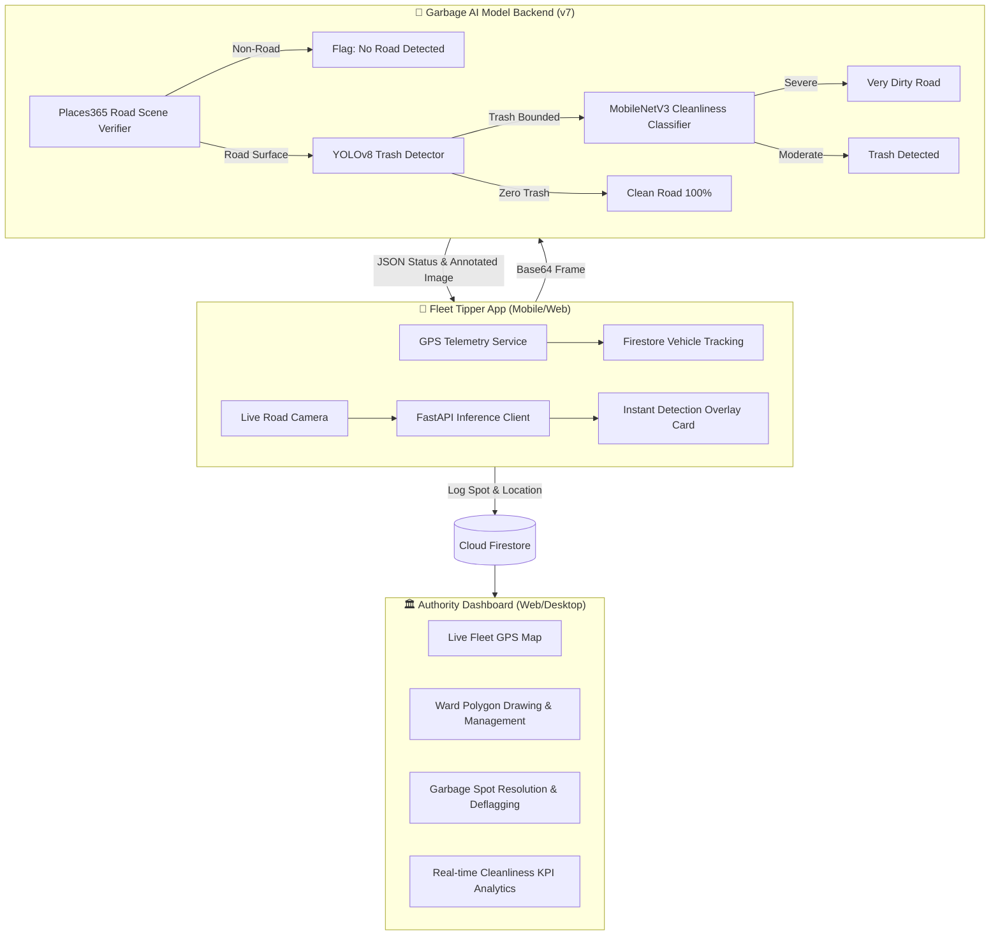

# Street AIQ — AI Waste Management & Smart Municipal Fleet Dispatch System

An intelligent municipal sanitation ecosystem integrating real-time computer vision, live IoT fleet telemetry, ward geofencing, and centralized authority monitoring.

---

## 🏗️ Architecture Overview



---

## 📦 Project Modules

### 1. 🏛️ `auth_app` — Municipal Authority Dashboard
- **Interactive Map**: Live OpenStreetMap displaying fleet trucks, ward boundary polygons, and AI-flagged waste pins.
- **Interactive Ward Drawing**: Click-to-draw custom municipal ward boundaries directly on the map.
- **Garbage Spot Review**: Filter by *Trash Detected*, *Clean Road*, *No Road*, *Resolved*, or *All Captures*. One-click deflagging with resolution status updates.
- **Fleet Management**: Real-time vehicle location, active speed, battery, driver assignments, and ward allocation.

### 2. 🚚 `fleet_app` — Driver & Tipper Vehicle App
- **Live Camera Scanning**: High-speed road scanning with automatic or manual snapshot capture.
- **Instant On-Screen Result Overlay**: Real-time visual feedback cards with colored status banners:
  - 🔴 **TRASH DETECTED** (High priority municipal cleanup needed)
  - 🟢 **NO TRASH** (Verified clean road)
  - 🟡 **NO ROAD DETECTED** (Camera pointed at non-road objects like indoor rooms, walls, or screens)
- **Automatic Telemetry**: Background GPS position streaming directly to Cloud Firestore.

### 3. 🧠 `Garbage_ai_model_v7` — Dual YOLOv8 + MobileNetV3 AI Backend
- **YOLOv8 Trash Object Detector**: Custom-trained model detecting waste objects on road surfaces.
- **MobileNetV3 Cleanliness Classifier**: Secondary deep learning classifier for severe dirtiness scoring.
- **Places365 Road Scene Verifier**: MIT Places365 ResNet-18 model combined with Laplacian variance analysis to reject non-road scenes (ceilings, walls, indoor rooms, screens).
- **FastAPI Server**: Running on port `5002` with `/process_frame`, `/api/snapshots`, and `/api/settings`.

### 4. 👥 `AIQ_CUSTOMER APP` — Citizen Cleanliness App
- Mobile and web application for citizens to report uncollected trash and track municipal cleanup operations.

---

## 🚀 Getting Started

### 1. Launch the AI Backend
```bash
cd Garbage_ai_model_v7
pip install -r requirements.txt
python app.py
```
*Server runs on `http://0.0.0.0:5002`.*

### 2. Run Authority App
```bash
cd auth_app
flutter run -d chrome --web-port 8080
```

### 3. Run Fleet Tipper App
```bash
cd fleet_app
flutter run -d chrome --web-port 8082
```
*Or build the Android APK:*
```bash
flutter build apk --release
```

---

## 🔒 Cloud Database
- **Provider**: Google Cloud Firestore (`takemytrash`)
- **Key Collections**:
  - `trash_spots`: Unified detection logs from all fleet vehicles.
  - `vehicles`: Live GPS, status, and assigned ward.
  - `wards`: Polygon geo-coordinates and zone mappings.

---

## 📄 License
MIT License
